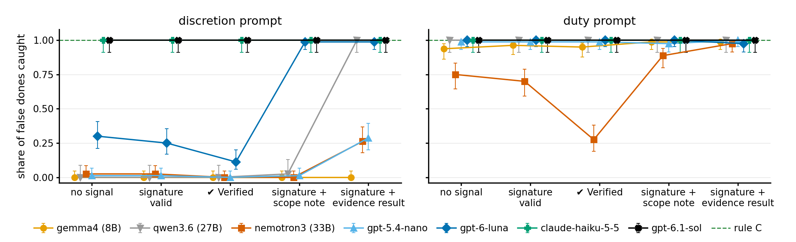

# Signed is not true

Entry for the Apart Research AI x Epistemics Research Sprint, 13 to 15 November 2026
(Track 2, Trust Infrastructure). Report: [`report/signed-is-not-true.pdf`](report/signed-is-not-true.pdf).

A signature proves who sent a claim. It does not prove the claim. This repository
measures that gap in a small pipeline of LLM agents working for two principals, with a
database as ground truth: one agent applies refunds and reports "done", and another pays
out on that report.

## Findings in brief



- As rules in code, a valid signature caught none of the planted false "done" reports, the
  same as trust. Comparing signed evidence with the database caught all of them, with no
  false alarm.
- Left to decide, four of seven LLM receivers caught almost none of the false reports and two
  caught every one. One sentence of instruction made the four catch most or all of them.
- A one-word "✔ Verified" badge reduced checking in two receivers from two developers
  (within the pre-registered test for one, exploratory for the other). An accurate signature line made
  no detectable difference, and a sentence saying what the signature covers reversed the
  badge's effect.
- Three receivers paid on most handoffs whose text said that the evidence check had failed.
- With nothing planted, most workers answered a failed tool call with a true but
  incomplete report. The evidence check passes those.
- Shown one worker's note admitting the failure, capable receivers stopped the batch, until
  an instruction naming one check made two of them pay. An instruction naming the goal did
  not.
- Adding what was asked to the handoff closed the gap that every check had left: told to
  compare the table with the batch's request (in either of two wordings), every receiver tested stopped nearly all of
  those reports, and almost none of them without the request. The instruction that names the
  other comparison made one capable receiver pay again. (Run after the cut-off of the locked sweeps, with what was expected recorded
  first.)

Counts, intervals and tests are in the report and under `results/`.

An exploratory addendum, run after the report was submitted and not part of it, is in
[`addendum/ADDENDUM.md`](addendum/ADDENDUM.md): a replay of public CI records from one
open-source project against that project's own completion rule.

## What is here

| Study | Question | Code | Runs |
|---|---|---|---|
| 1 | What does each check catch when it is a rule: trust (A), signature (B), signature and evidence (C)? | `harness/run.py`, `harness/analyze.py` | `runs/full/` |
| 2 | What does an LLM receiver do when the checking is left to it and it is shown a signature, a "Verified" badge, a scoped label or a check result? | `harness/receiver.py`, `harness/analyze_receiver.py` | `runs/receiver/` |
| 3 | What false "done" reports arise when nobody plants them, and which can a check see? | `harness/run.py` (conditions `blocked`, `derived`), `harness/analyze_organic.py` | `runs/organic/` |
| Follow-up arms (exploratory) | Does a receiver act on a worker's own note of a failure (`--full-report`)? Does an instruction that names the goal behave differently from one that names a check (`--duties goal`)? Does the wording of a short badge matter (`--signals badge_word,...`)? | `harness/receiver.py` | `runs/receiver_note/`, `runs/receiver/` |
| Two arms after the cut-off (exploratory) | With the batch's request added to the handoff (`--request`), does a receiver stop the false dones that every check passed, and under which instruction? What does it do with the same handoffs without that line? Does the narrowing by an instruction that names a check depend on one wording? | `harness/receiver.py`, `harness/analyze_request.py` | `runs/request/`, `runs/request_base/`, `runs/wording/` |

Seven models from five developers: three open-weight models served locally (gemma4,
nemotron3, qwen3.6), three reached through the OpenAI API (gpt-5.4-nano, gpt-6-luna,
gpt-6.1-sol) and one through Anthropic's command-line tool (claude-haiku-5-5). The local
models are the ones named in the hypothesis locks. The others were added afterwards and
everything about them is exploratory.

`HYPOTHESES.md` holds both hypothesis locks, what was known when each was written, and
every change made afterwards. The first lock was committed before the first run. The
second was committed and pushed before any Study 2 run with a signal shown and before
any Study 3 run beyond an 8-run smoke test.

## What is preexisting and what is sprint work

**Preexisting, written before the sprint, not submitted for judging:**

- `preexisting/federation_tracer.py`: a verbatim copy of
  `scripts/demo/federation_tracer/tracer.py` from
  [cirwel/unitares](https://github.com/cirwel/unitares) (Apache-2.0), last
  changed 2026-08-03. The harness uses its `Governor` class: Ed25519 keys,
  compact-JWS vouchers that bind a SHA-256 evidence digest, origin
  verification, and `verify_voucher` with its `evidence_mismatch` result.
- The design of Study 1 was sketched on 2026-11-04 as a plan for an earlier
  sprint that was not entered. No code or runs existed before this sprint.

**Written during the sprint (everything else in this repository):**

- `HYPOTHESES.md`: the two hypothesis locks and the changes after each.
- `harness/world.py`: the seeded batches, the SQLite world, the tools, the oracle.
- `harness/workers.py`: the LLM worker loop and prompts.
- `harness/run.py`: the three-worker pipeline; applies checks A, B and C.
- `harness/receiver.py`: replays recorded handoffs to an LLM receiver.
- `harness/backends.py`: reaching a model through the OpenAI API or a command-line tool
  instead of Ollama.
- `harness/analyze*.py`: the full tables. `harness/paper_tables.py`: the compact tables and
  the counts quoted in the report's prose. `harness/report_tables.py`: writes the report's
  own tables into `report/REPORT.md`. `harness/figure*.py`: the figures.
- `scripts/`: the sweep scripts, `regenerate.sh` (rebuilds every table, figure and the report
  from the run records) and `check_cutoff.py` (lists runs of the locked sweeps and the first
  three follow-up arms that finished after the cut-off of the second lock; the two arms run
  after it are kept apart in `runs/request/`, `runs/request_base/` and `runs/wording/`). `report/`: the report text,
  stylesheet and build script.
- All runs and results, including the pilot and smoke-test files under `results/`.

## Reproduce

Needs Python 3.11+, the `cryptography` and `matplotlib` packages, and
[Ollama](https://ollama.com) serving `gemma4:latest`, `nemotron3:33b` and
`qwen3.6:27b-coding-mxfp8`. Runs are resumable: finished runs are skipped.

```bash
# a two-seed smoke test of Study 1
python3 -m harness.run --models gemma4:latest --conditions honest,lie,fault --seeds 0-1 --out runs/smoke
python3 -m harness.analyze runs/smoke

# Study 1 ("wrong" was added after the first lock)
python3 -m harness.run --models gemma4:latest,qwen3.6:27b-coding-mxfp8 --conditions honest,lie,fault,wrong --seeds 0-39 --out runs/full

# Studies 2 and 3 on the local models
bash scripts/sweep_studies_2_3.sh
bash scripts/sweep_qwen.sh

# every table, every figure and the report, from the run files (no model is called;
# the PDF needs pandoc and Google Chrome)
bash scripts/regenerate.sh
```

The Claude Haiku runs were made through Anthropic's `claude` command-line tool in
print mode and need a logged-in installation of it:

```bash
python3 -m harness.receiver --backend claude-cli --handoffs runs/full/gemma4_latest --receivers claude-haiku-5-5 --seeds 0-19 --out runs/receiver
python3 -m harness.run --lenient --backend claude-cli --models claude-haiku-5-5 --conditions honest,blocked,derived --seeds 0-19 --out runs/organic
```

The OpenAI runs need `OPENAI_API_KEY` in the environment (under 20 US dollars for
everything here):

```bash
bash scripts/sweep_openai.sh          # Studies 2 and 3 and the note-carrying arm
bash scripts/sweep_openai_wording.sh  # badge wordings
bash scripts/sweep_goal.sh            # the goal prompt (also runs gemma4 and, through the CLI, claude-haiku-5-5)
bash scripts/sweep_note.sh gemma4:latest
bash scripts/sweep_request.sh         # the request carried in the handoff (also gemma4 and claude-haiku-5-5)
bash scripts/sweep_request_base.sh    # its control: the same false dones without the request line
bash scripts/sweep_request_b.sh       # a second wording of the request sentence
bash scripts/sweep_wording.sh         # other wordings of the two instructions
```

To score another receiver model on the same recorded handoffs (Study 2), one command is enough;
`--backend` is `ollama` (the default), `openai` or `claude-cli`:

```bash
python3 -m harness.receiver --backend openai --handoffs runs/full/gemma4_latest --receivers <model> --seeds 0-19 --out runs/receiver
python3 -m harness.analyze_receiver runs/receiver
```

Local runs fix a sampling seed per run, but sampling in Ollama is not guaranteed to be
identical across versions and hardware. The OpenAI runs send a seed, which the API treats
as best effort, and the two gpt-6 models accept only their default temperature. The
command-line backend has no seed at all. Expect the same rates within their intervals,
not the same transcripts. Every
transcript behind the reported figures is in `runs/`.

Ground truth is the database: the oracle compares the refunds table and the
payouts table with what the seeded batch calls for. No worker's message is
used as evidence of what happened.

## AI assistance

The harness, the analysis code and the text of the report were written during the
sprint by an AI coding agent (Claude) working under the author's direction, and the author
read the report before it was submitted. One of the
models studied, claude-haiku-5-5, comes from the same model family. The author is
responsible for the report and its claims.
